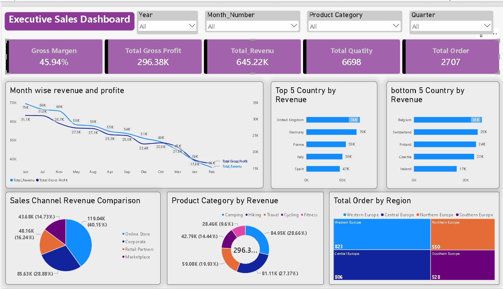

# Executive Sales Dashboard | Power BI

## Project Overview
This project presents an interactive Executive Sales Dashboard built using Microsoft Power BI to explore sales performance, revenue, profitability, product categories, and regional orders.

## Tools Used
- Microsoft Power BI
- Power Query (if used)
- DAX (if used)

## Key Performance Indicators (KPIs)
- Gross Margin: 45.94%
- Total Gross Profit: 296.38K
- Total Revenue: 645.22K
- Total Quantity: 6,698
- Total Orders: 2,707

*Values shown are from the dashboard screenshot and may change when filters are applied.*

## Dashboard Features
- Month-wise revenue and gross profit comparison
- Top 5 and bottom 5 countries by revenue
- Sales channel revenue comparison
- Product category revenue analysis
- Total orders by region
- Interactive filters for year, month, product category, and quarter

## Project File
- `Executive_Sales_Dashboard.pbix` — Power BI report file.

## Key Insights
The dashboard provides a view of revenue, gross profit, sales channels, product categories, and regional order distribution. Specific business conclusions should be added after validating the data and filter selections.

## Dashboard Preview

## Author
Mohammd-Insaf
